# ECS Project: IT-Tools on AWS Fargate

## Overview

This project deploys IT-Tools, an existing open source developer-tools web app, on AWS. The app is packaged in a multi-stage Docker image, stored in ECR, and run on ECS Fargate behind an Application Load Balancer. It is served over HTTPS on a custom domain, with plain HTTP redirected to HTTPS using a 301 (permanent) status.

I first built everything by hand in the AWS console (ClickOps) to understand each part, then rebuilt it in Terraform and automated the deployment with GitHub Actions, which authenticates to AWS using OIDC so no AWS access keys are stored.

The stack has been destroyed to avoid hourly costs. Screenshots of the full process and results are in [`docs/screenshots`](docs/screenshots).


## Architecture

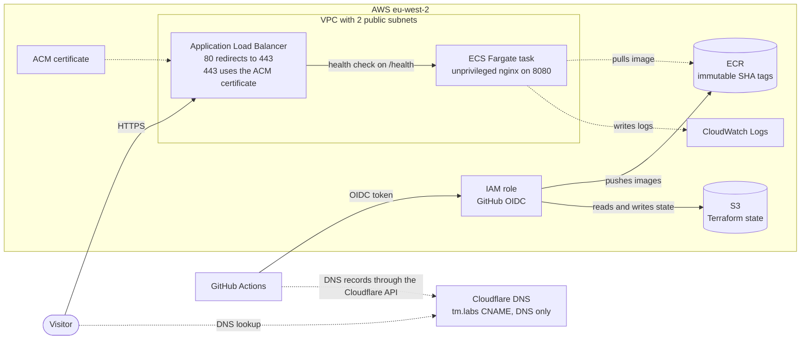

| Component | Purpose |
|---|---|
| VPC, two public subnets, internet gateway and route table | The network the load balancer and container run in |
| Application Load Balancer | The public entry point: redirects HTTP to HTTPS and forwards HTTPS to the container |
| Target group | The list of containers the load balancer sends traffic to, with a health check on `/health` |
| ECS Fargate | Runs the container without any servers to manage |
| ECR | Private store for the Docker images, with immutable tags and scan on push |
| ACM | The HTTPS certificate for the domain |
| Cloudflare DNS | Holds the domain and the DNS records (outside AWS) |
| Security groups | The load balancer accepts ports 80 and 443 from the internet, and the container accepts port 8080 only from the load balancer |
| ECS task execution role | Lets ECS pull the image and write logs |
| GitHub OIDC role | Lets the pipeline log in to AWS without stored access keys |
| CloudWatch Logs | Keeps the container's logs for 7 days |
| S3 bucket | Stores the Terraform state, versioned, encrypted and locked |
| GitHub Actions | Builds the image and runs Terraform plan, apply and destroy |

**How a request flows:** the visitor's browser asks Cloudflare DNS for `tm.labs.yahyejama.win` and gets the load balancer's address. It then connects to the load balancer over HTTPS, and the load balancer forwards the request to the container on port 8080.


## The container

The app runs from a Docker image built in two stages (see [`app/Dockerfile`](app/Dockerfile)).

- **Stage 1 (build):** uses Node and pnpm to turn the IT-Tools source code into ready-to-serve website files.
- **Stage 2 (run):** starts from a small nginx image and copies in only those finished files. Node, pnpm and the source code are left behind, so the final image is small (about 27 MB).

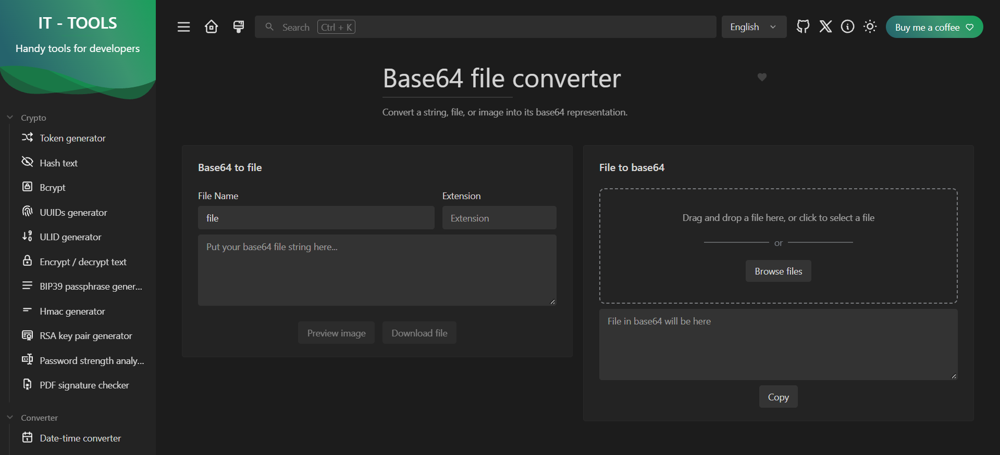

**Running as non-root:** nginx runs as a normal user, not as root. If someone ever broke into the container, they would have very little power. I checked this by running `whoami` inside the container, and it printed `nginx`.

**Port 8080:** normal users can't use ports below 1024, so nginx listens on 8080. The load balancer takes traffic on ports 80 and 443 and passes it to 8080, so visitors never notice.

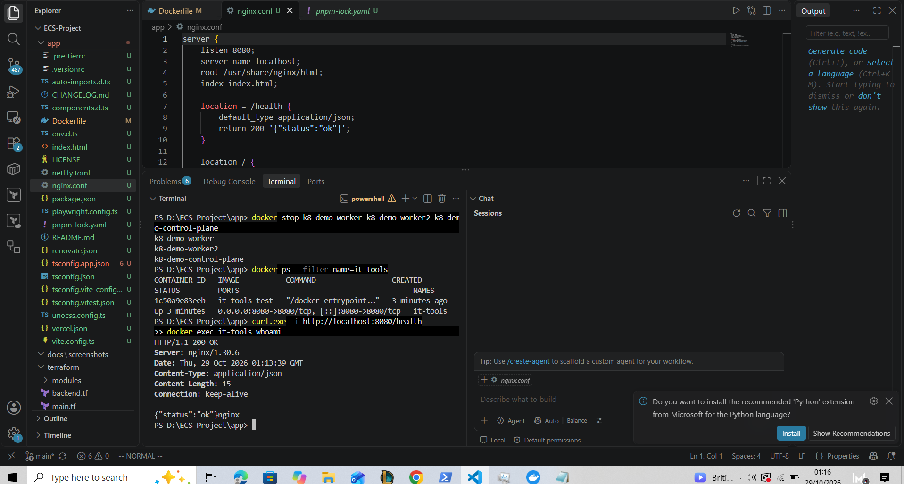

**Health check:** I added a `/health` page to [`nginx.conf`](app/nginx.conf). It returns `{"status":"ok"}`. The load balancer asks this page whether the container is working.

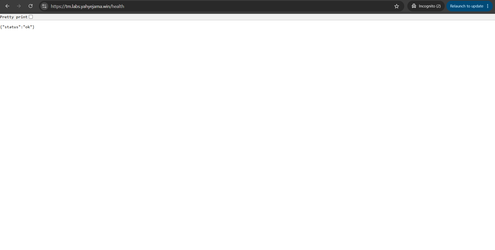 

**Image storage:** the image is pushed to Amazon ECR. Each image is tagged with the short commit ID, so I can always tell which code it was built from.

 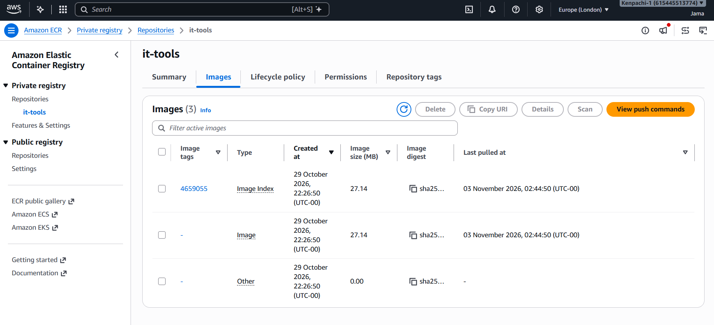 

**One trade-off:** the build skips IT-Tools' TypeScript check, because running it ran out of memory on my laptop. 


## Phase 1: ClickOps

I built the whole setup by hand in the AWS console first, so I could see what each piece does before turning it into code. This was done in London (`eu-west-2`) and roughly in this order:

1. **ECR repository:** stores the Docker image.
2. **ECS cluster** (Fargate): where the container runs.
3. **Task execution role and task definition:** the role lets ECS pull the image and write logs. The task definition says which image to run, how much CPU and memory it gets (0.5 vCPU, 1 GB) and which port it uses (8080).
4. **Two security groups:** one for the load balancer (ports 80 and 443 open to the internet) and one for the container (port 8080, only from the load balancer).
5. **Target group:** the list of containers the load balancer sends traffic to. Its health check calls `/health`.
6. **Application Load Balancer and ECS service:** the load balancer faces the internet, and the service keeps one container running behind it.
7. **ACM certificate and DNS records:** gives the site HTTPS on my own domain.
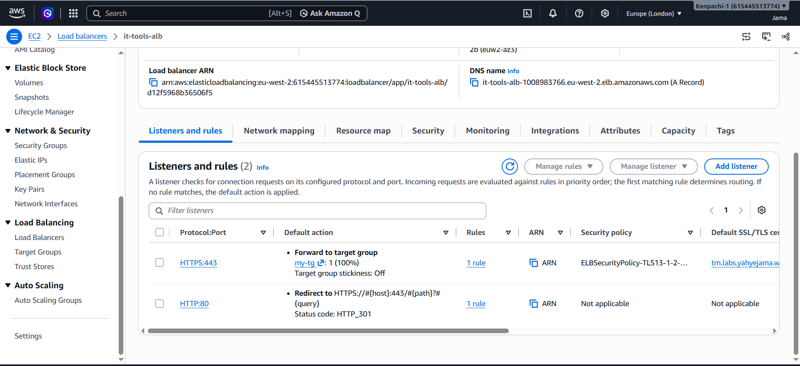

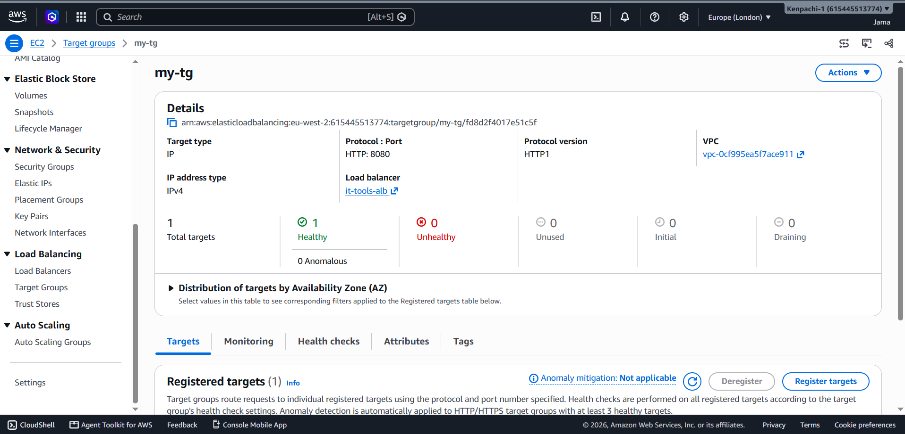
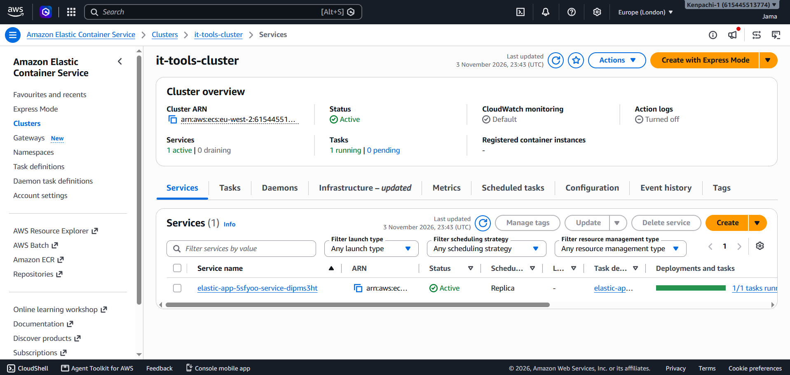

**The problem:** the container kept failing to start, with an error saying it couldn't reach ECR to pull its image.

**The cause:** the container's security group had a wrong outbound rule, so nothing could leave the container, including the call to ECR.

**The fix:** I added an outbound rule allowing all traffic, then forced a new deployment. The container started and the target turned healthy. I carried this lesson into Terraform, where outbound rules have to be written out explicitly.

**The result:** the site worked over HTTPS on my domain. HTTP requests were redirected to HTTPS with a 301, and `/health` returned `{"status":"ok"}`.
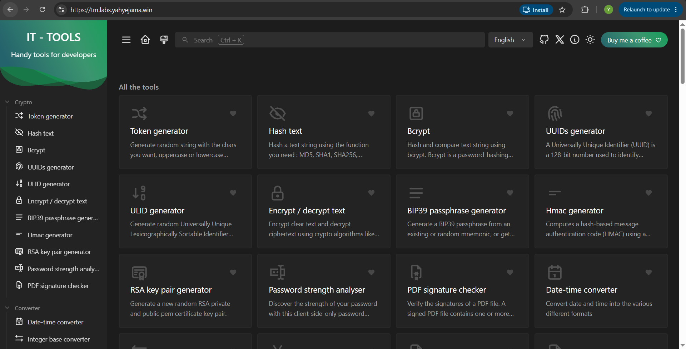

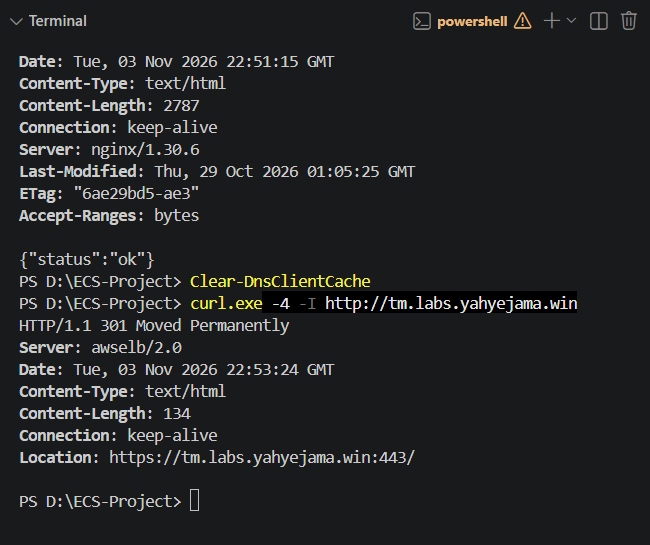

**Before tearing it down:** I took screenshots and noted the settings I had chosen, because they became the blueprint for the Terraform version. Then I deleted the load balancer, service, target group, cluster and security groups to stop the hourly charges. The ECR repository, domain and certificate were kept.


## Phase 2: Terraform

After the manual build, I rebuilt the same setup as code in the [`terraform/`](terraform) folder. Terraform is the tool that creates the AWS resources from files, so the whole setup can be rebuilt or destroyed with one command.

**How the code is organised**

| Part | What it holds |
|---|---|
| `modules/vpc` | The network: a VPC, two public subnets in different availability zones, an internet gateway and a route table |
| `modules/ecr` | The image repository, with immutable tags, scan on push and a rule that keeps only the latest 10 images |
| `modules/alb` | The load balancer, its security group, the target group (health check on `/health`), and two listeners: port 80 redirects to HTTPS, port 443 forwards to the container |
| `modules/ecs` | The cluster, task definition, service, container security group, log group and the task execution role |
| `dns.tf` | The ACM certificate, the DNS record that proves I own the domain, and the `tm.labs` record that points at the load balancer |
| `oidc.tf` | The GitHub OIDC provider and the role that the pipeline uses to log in to AWS |
| `main.tf` | Calls the modules and connects them (for example, passes the subnets from the VPC to the load balancer) |

The DNS records are created in Cloudflare using the Cloudflare Terraform provider. It uses an API token limited to editing DNS for one domain, and the token is read from an environment variable, never stored in the code.

**Where the state lives**

Terraform keeps a record of everything it has built, called the state file. Mine is stored in an S3 bucket, not on my laptop, so the pipeline and I share the same record. The bucket has versioning on (so I can recover an older copy), encryption on, and all public access blocked. State locking is on, so two runs can't change things at the same time. I created this bucket by hand once, because Terraform can't create the bucket that stores its own state.

**Two design choices**

- **Immutable image tags:** once an image tag is pushed to ECR, it can never be overwritten. Each image is tagged with its commit ID, so a tag always points at the same code.
- **Explicit outbound rules:** Terraform removes the default "allow all outbound traffic" rule from security groups, so I wrote the outbound rules into the code. This came straight from the ClickOps problem, where a missing outbound rule stopped the container from reaching ECR.

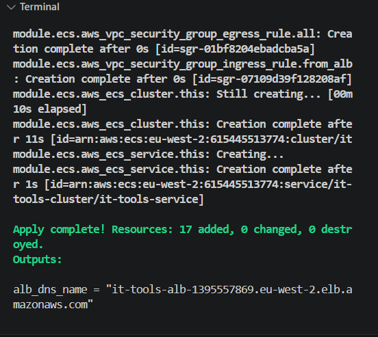

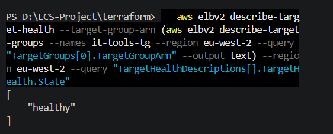

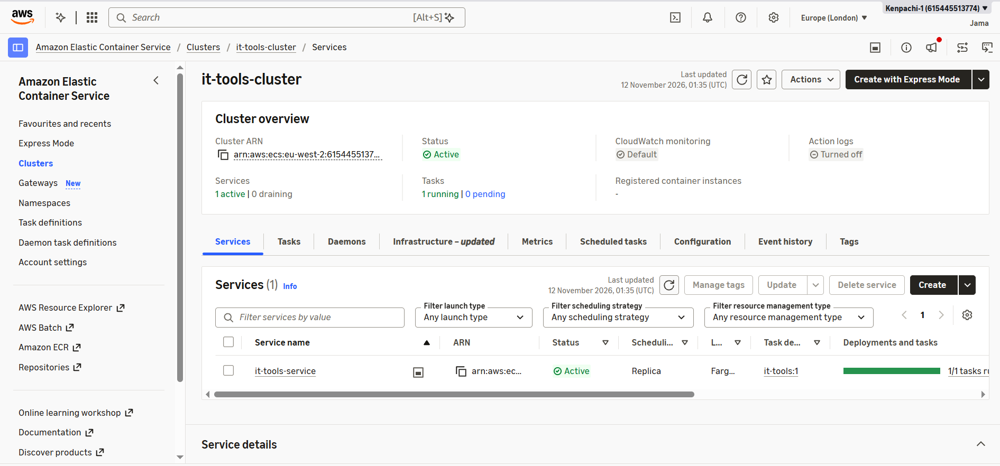

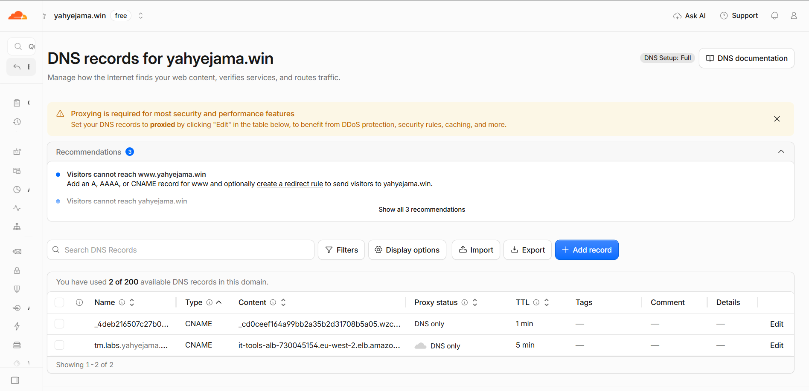

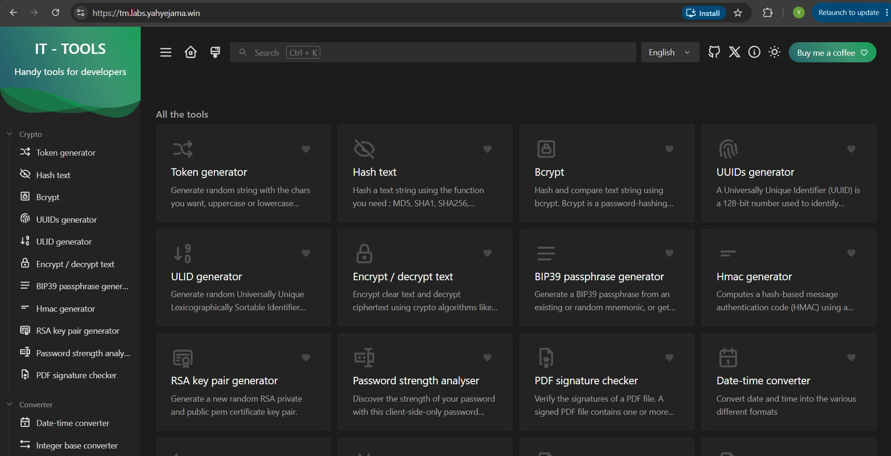

**Keeping costs down:** the load balancer and the container bill by the hour, so after testing I destroyed just those two modules (`terraform destroy` with `-target`) and kept the free parts, such as the network and the image repository.

## CI/CD pipeline

The pipeline is four GitHub Actions workflows in [`.github/workflows`](.github/workflows).

| Workflow | Trigger | What it does |
|---|---|---|
| **App build and push** | A push to `main` that changes `app/`, or a manual run | Logs in to AWS, builds the Docker image, and pushes it to ECR tagged with the short commit ID. If that tag already exists, it skips the push, because the repository doesn't allow tags to be overwritten. |
| **Terraform plan** | A pull request that changes `terraform/`, or a manual run | Checks the formatting, validates the code, and shows what Terraform would change. It creates nothing. |
| **Terraform apply** | A push to `main` that changes `terraform/`, or a manual run | Builds the infrastructure with Terraform, then checks that the live site is healthy. |
| **Terraform destroy** | Manual only. You must type `destroy` to confirm. | Removes the load balancer and the ECS service, which are the parts that bill by the hour. |

**No AWS keys are stored.** Each run gets a short-lived login token from GitHub. AWS is set up to trust GitHub, and the IAM role only accepts tokens from this repository, from the `main` branch and from pull requests. The workflow swaps the token for temporary AWS credentials that expire after the run. The only stored secret is the Cloudflare API token, which is kept as an encrypted GitHub secret and can only edit DNS for this domain.

**Finding the image to deploy:** Terraform needs to know which image tag to run. The plan and apply workflows ask ECR for the most recently pushed image and pass its tag to Terraform, so nobody has to type it in.

**The health check:** after the apply, the workflow requests `https://tm.labs.yahyejama.win/health` every 20 seconds, for up to 10 minutes. It passes only when it gets a 200 response containing `{"status":"ok"}`. If the site never answers, the whole run fails.

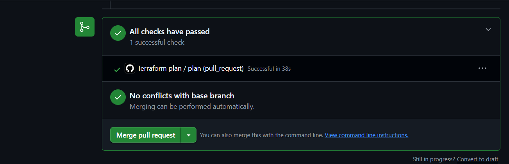

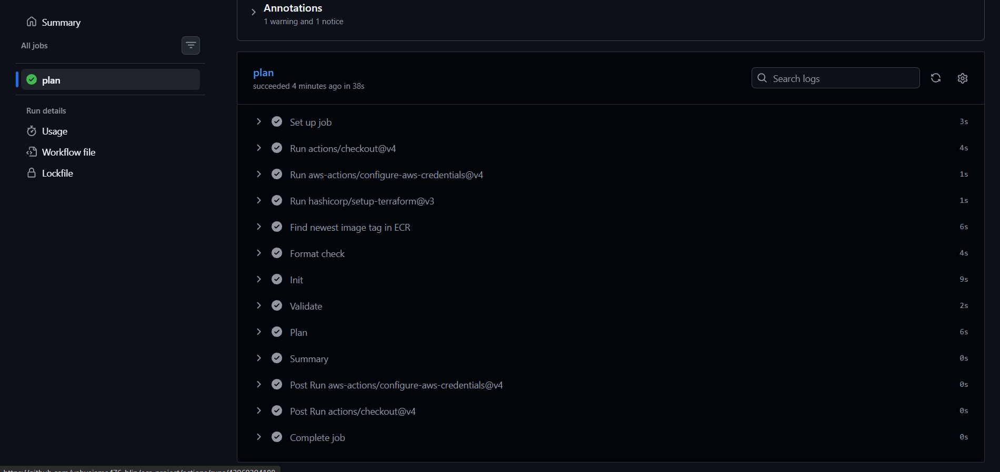

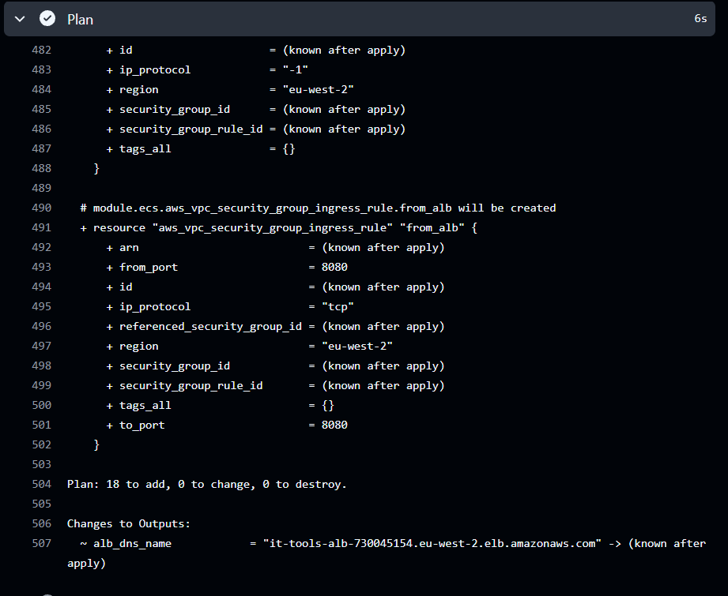

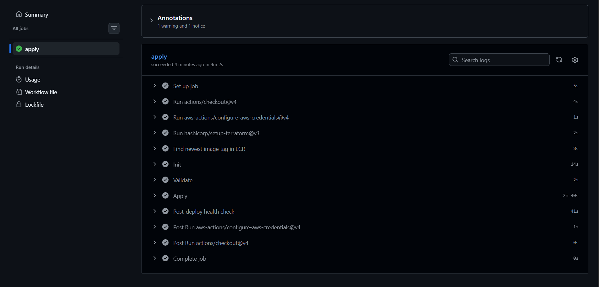

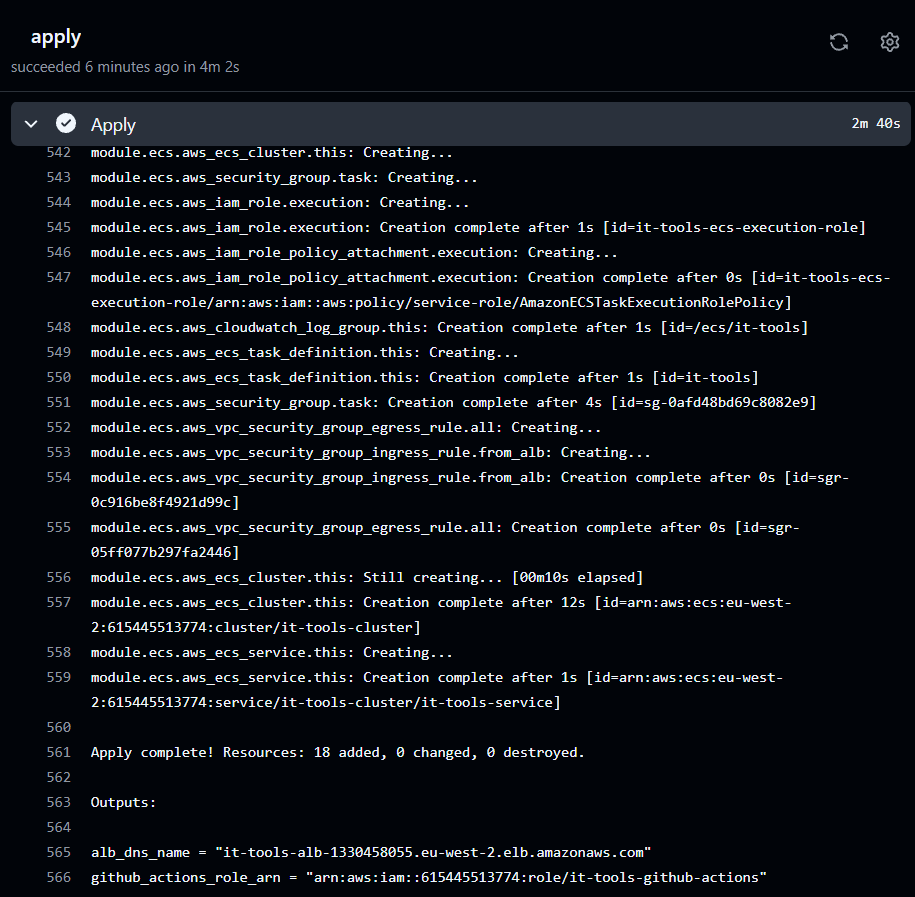

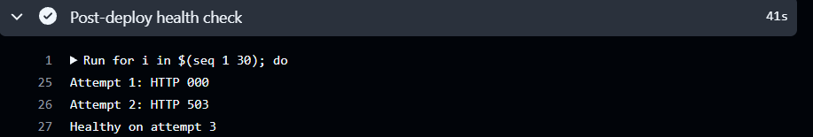

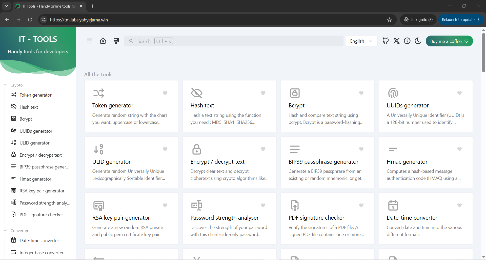

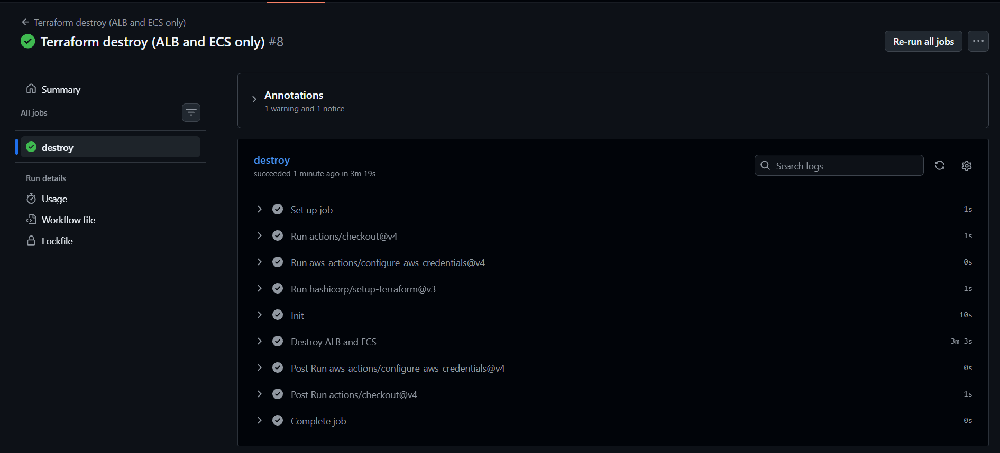

**Limitation:** building an image and deploying it are separate steps. After a new image is built, I start the apply workflow manually, and it picks up the newest image. Linking the two automatically is one of the improvements listed at the end of [Decisions and lessons](#decisions-and-lessons).

## Domain and DNS

The site's address is `tm.labs.yahyejama.win`. The domain, `yahyejama.win`, is registered with Cloudflare, and its DNS records are managed in Cloudflare too.

**Why not Route 53?** I planned to buy the domain through AWS, but my AWS account is on the free plan and the console refused with "Free Tier accounts are not supported for this service". I then tried buying it at Cloudflare and pointing it at an AWS Route 53 hosted zone, but Cloudflare's docs say a domain registered with them has to use Cloudflare's own DNS. So the DNS records live in Cloudflare, and AWS only provides the certificate and the load balancer.

**The two DNS records**

| Record | Type | Points to | Purpose |
|---|---|---|---|
| Certificate validation | CNAME | A name given by AWS Certificate Manager | Proves to AWS that I own the domain, so it will issue the HTTPS certificate |
| `tm.labs` | CNAME | The load balancer's address | Sends visitors of `tm.labs.yahyejama.win` to the site |

Both records are created by Terraform (`dns.tf`) using the Cloudflare provider, so they are rebuilt each time the stack is.

**Why the records are "DNS only" (proxy off):** Cloudflare can sit in front of a site as a proxy (the orange cloud). I turned it off for both records. Cloudflare rejected a proxied certificate-validation record, and when the site record was proxied, the browser showed an SSL error, because the visitor connected to Cloudflare instead of reaching my load balancer and its AWS certificate. With the proxy off, DNS just points the name at the load balancer.


## How to reproduce

### What you need
- An AWS account, with an IAM user (not the root user) and the AWS CLI set up on your computer
- Terraform 1.11 or newer, and Git
- A domain whose DNS is managed in Cloudflare
- A GitHub repository containing this code (a fork or a copy)

### Values to change for your own setup

| File | What to change |
|---|---|
| `terraform/backend.tf` | The S3 bucket name (it has to be unique across all of AWS) |
| `terraform/variables.tf` | `cloudflare_zone_id` (your Cloudflare zone ID) and `github_repo` (see the note below) |
| `terraform/dns.tf` | The domain names (`tm.labs.yahyejama.win` and `tm.labs`) |
| `.github/workflows/*.yml` | Your AWS account ID in the `role-to-assume` line (all four workflows) and the health check URL in `terraform-apply.yml` |
| `terraform/providers.tf` and `terraform/main.tf` | The region, if you don't want `eu-west-2` |

**Note on `github_repo`:** newer GitHub repositories put permanent IDs in the OIDC login token, so the value has to be in the form `owner@owner-id/repo@repo-id`. Get both IDs from `https://api.github.com/repos/OWNER/REPO` (the repo's `id` and the owner's `id`).

### Steps

1. **Create the Terraform state bucket by hand.** Terraform can't create the bucket that stores its own state. In S3, create a bucket with versioning on, encryption on and all public access blocked.
2. **Create a Cloudflare API token** with permission to edit DNS for your domain only. Add it to the GitHub repository as an Actions secret named `CLOUDFLARE_API_TOKEN`.
3. **Edit the values** from the table above and push the code to your GitHub repository.
4. **Set your credentials in your terminal** (the AWS CLI should already be logged in):

```
   export CLOUDFLARE_API_TOKEN="your-token"
```

   In PowerShell, use `$env:CLOUDFLARE_API_TOKEN = "your-token"`.
5. **Initialise Terraform:**

```
   cd terraform
   terraform init
```

6. **Create the pipeline's AWS login first** (the GitHub OIDC provider, the role and its permissions). The pipeline can't run until this role exists:

```
   terraform apply -target=aws_iam_openid_connect_provider.github -target=aws_iam_role.github_actions -target=aws_iam_role_policy.github_actions -var "image_tag=bootstrap"
```

   In PowerShell, wrap each `-target=...` in single quotes.
7. **Create the ECR repository on its own.** The apply workflow looks up the newest image in ECR, so the repository needs an image before the full apply:

```
   terraform apply -target=module.ecr -var "image_tag=bootstrap"
```

8. **Build and push the first image.** In GitHub go to Actions, choose **App build and push** and click **Run workflow**. Check that an image tagged with a short commit ID appears in ECR.
9. **Deploy everything.** Go to Actions, choose **Terraform apply** and click **Run workflow**. It builds the network, load balancer, ECS service, certificate and DNS record, then checks `/health` on the live URL and fails if the site doesn't answer.
10. **Open your URL.** For this project it was `https://tm.labs.yahyejama.win`.

### Tearing it down

1. Run **Terraform destroy** in Actions and type `destroy`. This removes the load balancer and the ECS service, which are the parts that bill by the hour.
2. To remove everything else (network, ECR, certificate, DNS records and the pipeline role), run this from your computer:

```
   terraform destroy -var "image_tag=bootstrap"
```

3. Delete the state bucket and the Cloudflare token by hand.


## Decisions and lessons

Problems I hit while building this, and how I fixed them.

**1. The Docker build crashed after about 20 minutes**
- **Problem:** building the image on my 8 GB laptop kept failing with `error reading from server: EOF`, because Docker's build engine most likely ran out of memory.
- **Fix:** I gave Docker more memory and swap through a `.wslconfig` file. In the Dockerfile I run `vite build` directly with a capped Node memory limit, which skips the TypeScript check. The build now takes about 5 minutes.

**2. The container couldn't reach ECR**
- **Problem:** the ECS task failed to start with a timeout when pulling its image, because its security group had no useful outbound rule.
- **Fix:** I added a rule that allows all outbound traffic. In Terraform the outbound rules are written out explicitly, because Terraform doesn't add one by default.

**3. AWS wouldn't let me register the domain**
- **Problem:** my AWS account is on the free plan, which blocks domain registration in Route 53, and Cloudflare's registrar needs its own DNS, so I couldn't use a Route 53 hosted zone either.
- **Fix:** DNS stays in Cloudflare and is managed with Terraform using the Cloudflare provider and a token that can only edit DNS for this domain.

**4. The Cloudflare proxy broke HTTPS**
- **Problem:** with the proxy on (the orange cloud), Cloudflare rejected the certificate validation record, and the site showed an SSL error.
- **Fix:** both DNS records are set to "DNS only", so the name points straight at the load balancer.

**5. The pipeline couldn't log in to AWS**
- **Problem:** the first pipeline run failed with `Not authorized to perform sts:AssumeRoleWithWebIdentity`, even though my role looked correct.
- **Fix:** AWS's CloudTrail log showed the exact login name GitHub sent. For newer repositories it includes permanent IDs (`repo:owner@id/repo@id`). I changed the role's trust policy to match, which is also stricter, because a deleted and re-created repo with the same name wouldn't match.

**6. The pipeline caught my mistakes**
- **Problem:** the first plan run failed because a variable only existed in my own terminal, and the next run failed because I had declared the same variable twice.
- **Fix:** I gave the variable a default value and removed the duplicate. I now run `terraform fmt` and `terraform validate` before every push.

**7. Terraform modules can't see each other**
- **Problem:** I pasted code into the wrong files, and Terraform failed with "Unreadable module directory".
- **Fix:** modules only use their own inputs. The root `main.tf` connects them, for example by passing the network's subnets to the load balancer.

**8. `/health` showed an IT-Tools "404" in my browser**
- **Problem:** IT-Tools installs a service worker in the browser, which answered the request from its cache before it reached my server.
- **Fix:** I tested with `curl` and a private window, and the pipeline's health check uses `curl`, so it isn't affected.

### What I would improve next
- **Narrower permissions:** the pipeline role is limited by service, but not by individual resource.
- **An approval step before apply,** so a merge doesn't deploy straight away.
- **Deploy automatically after an image build.** Right now the apply is started separately.
- **More checks in CI,** such as `tflint` and the TypeScript type check.
- **Private subnets for the containers.** They run in public subnets with public IPs, protected by security groups, to avoid the cost of a NAT gateway.

## Credits

The application is [IT-Tools](https://github.com/CorentinTh/it-tools) by Corentin Thomasset, an open source collection of developer tools. I did not write the app. My work in this project is everything around it: the Docker image, the AWS infrastructure, the Terraform code, the DNS setup and the CI/CD pipeline.

IT-Tools is licensed under the **GNU General Public License v3.0**. The original licence file is kept in [`app/LICENSE`](app/LICENSE). The IT-Tools source in the `app/` folder is unchanged, apart from the `Dockerfile` and `nginx.conf`, which I rewrote for this project.
